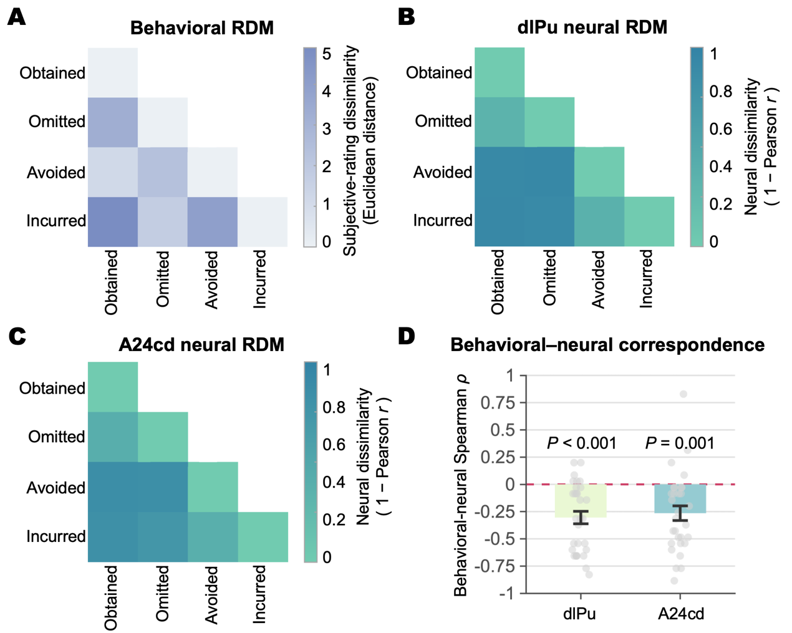
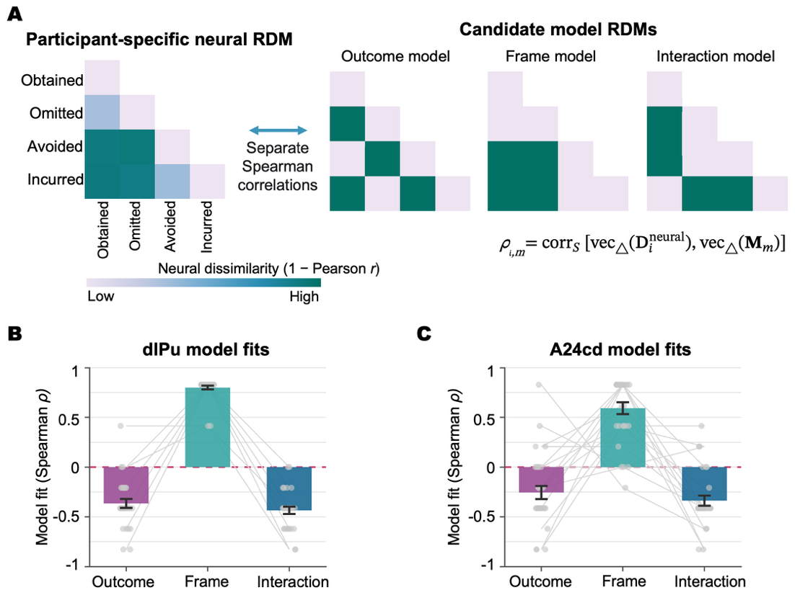

# Representational Analysis and Statistical Methods

[Project overview](../README.md) · [Analysis index](../analysis-index.md) · [Supplementary-analysis methods](../2.Supplementary/Supplementary.md)

## 1. Research question and inputs

Representational similarity analysis (RSA) characterizes multivoxel pattern structure across feedback conditions and relates it to subjective experience and candidate models. Inputs include participant-level condition beta images from first-level GLMs, anatomical ROI masks, condition labels, and subjective ratings.

<table align="center">
<thead><tr><th align="left">Condition name</th><th align="left">Feedback outcome</th></tr></thead>
<tbody>
<tr><td align="left">Reward-obtained</td><td align="left">Reward obtained: +¥3</td></tr>
<tr><td align="left">Reward-omission</td><td align="left">Reward omitted: ¥0</td></tr>
<tr><td align="left">Loss-avoidance</td><td align="left">Loss avoided: ¥0</td></tr>
<tr><td align="left">Loss-incurrence</td><td align="left">Loss incurred: −¥3</td></tr>
</tbody></table>

A 4 × 4 neural representational dissimilarity matrix (RDM) is constructed for each participant and ROI. Rows and columns follow the condition order in the table. Participant-level matrices are stored in a condition × condition × participant array.

## 2. RDM construction

### Neural RDMs

For each participant and ROI, first-level GLM beta estimates were extracted for the four conditions. Pearson correlations between spatial patterns were computed across corresponding voxels, with neural dissimilarity defined as **1 − Pearson r**. Statistical analyses used the six unique off-diagonal distances in the upper triangle of the matrix.

### Behavioral RDMs

Subjective ratings covered frustration, valence, surprise, controllability, and reference violation. Each dimension was standardized across the four conditions within each participant. Euclidean distances between conditions then formed the participant's behavioral RDM.

## 3. Behavioral–neural correspondence

Spearman correlations were calculated between the six matched distances in each participant's behavioral and neural RDMs for each ROI. Correlations were Fisher z-transformed and tested against zero using two-sided one-sample t tests. The main results figure reports uncorrected p values from these tests. Supplementary analyses used participant-level sign-flipping tests and examined correspondence after removing rating dimensions.

## 4. Candidate-model comparison

The Outcome model groups conditions by goal attainment, and the Frame model groups them by reward versus loss task. The cross-grouping model specifies a crossed pairing of conditions. Model matrices are defined in the [core RSA code](rsa_core.m).

<table align="center">
<thead><tr><th align="left">Model</th><th align="left">Condition pairs predicted to be more similar</th></tr></thead>
<tbody>
<tr><td align="left">Outcome model</td><td align="left">Reward-obtained and Loss-avoidance; Reward-omission and Loss-incurrence</td></tr>
<tr><td align="left">Frame model</td><td align="left">Reward-obtained and Reward-omission; Loss-avoidance and Loss-incurrence</td></tr>
<tr><td align="left">Cross-grouping model</td><td align="left">Reward-obtained and Loss-incurrence; Reward-omission and Loss-avoidance</td></tr>
</tbody></table>

For each participant and ROI, the neural RDM was correlated with each of the three model RDMs using Spearman correlation. Model fits were compared with two-sided paired t tests. Holm correction was applied across the three model comparisons within each ROI.

<table align="center">
<thead><tr><th align="left">Analysis</th><th align="left">Participant-level input</th><th align="left">Method</th><th align="left">Output</th></tr></thead>
<tbody>
<tr><td align="left">Behavioral–neural correspondence</td><td align="left">Behavioral and neural distance vectors from the same participant</td><td align="left">Spearman correlation, Fisher z transformation, and one-sample testing</td><td align="left">Individual correlations and group-level tests</td></tr>
<tr><td align="left">Candidate-model fitting</td><td align="left">Neural and theoretical-model distance vectors</td><td align="left">Spearman correlation, paired comparisons, and Holm correction</td><td align="left">Model-fit and comparison tables</td></tr>
<tr><td align="left">Sensitivity to rating dimensions</td><td align="left">Behavioral RDMs based on all or a subset of rating dimensions</td><td align="left">Recalculated correlations and within-participant comparisons</td><td align="left">Rating-dimension sensitivity summaries</td></tr>
<tr><td align="left">Acquisition-quality sensitivity</td><td align="left">Representational measures, acquisition order, FD, and tSNR</td><td align="left">Covariate regression and comparisons before and after adjustment</td><td align="left">Regression tables and association plots</td></tr>
</tbody></table>

## 5. Sensitivity analyses

Acquisition factors included scan order, head motion, and between-session differences in signal quality. Quality measures included mean and maximum framewise displacement (FD), the proportion of high-motion volumes, and ROI temporal signal-to-noise ratio (tSNR). Depending on the analysis target, signed or absolute between-session differences were included in covariate models.

Further sensitivity analyses examined the removal of rating dimensions, participant influence, and model specifications. Checks for GLM, ROI, PM, and decoding analyses were tailored to their respective targets; see [Supplementary-analysis methods](../2.Supplementary/Supplementary.md#sensitivity).

## 6. Figure and table summaries

The group behavioral RDM was constructed from aggregated ratings. Group neural RDMs were computed by averaging participant-level matrices element by element. Behavioral–neural correlations and model fits were plotted using individual coefficients, with participant points, within-participant lines, means, and standard errors of the mean. Matrices, individual coefficients, and statistical tables were organized by participant, ROI, condition, and model.

## 7. Software and my contribution

First-level GLMs were estimated in SPM. ROI pattern extraction, RDM construction, model fitting, and statistical summaries were performed mainly in MATLAB. R and Python also supported data organization and additional statistical work.

I matched participant and condition records, configured ROIs and models, calculated RDMs, fitted models, performed statistical comparisons and sensitivity analyses, and prepared figures and tables.

## Research figures

