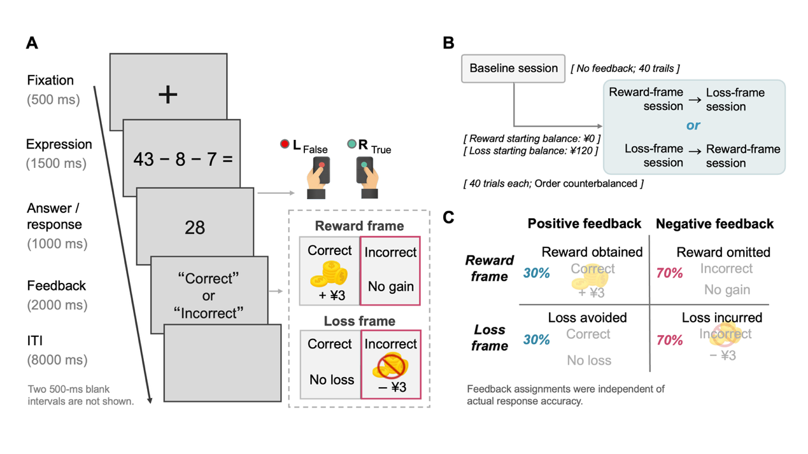
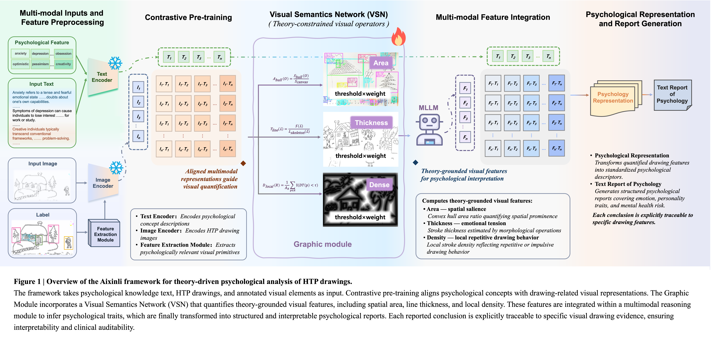

# Wanting It but Not Getting It, or Having It Only to Lose It? An fMRI Study of Reward Omission and Loss Incurrence

[Experimental workflow](workflow.md) · [Analysis index](analysis-index.md) · [Representational analysis and statistical methods](1.RSA/methods-and-statistics.md) · [Core RSA code](1.RSA/rsa_core.m) · [Supplementary analyses](2.Supplementary/Supplementary.md)

This study grew out of my interest in two basic motivations for human survival: seeking gains and avoiding harm. How does the frustration people experience differ when they fail to gain something versus when they fail to avoid harm? I framed this question as the distinction between "wanting it but not getting it" and "having it only to lose it." The former refers to a desired gain that is not obtained; the latter to the loss of something already held. I wanted to know whether their neural representations are more similar to each other or to those of goal attainment in their respective contexts.

The study examines this question through reward-seeking and loss-avoidance tasks in the same participants. It compares fMRI multivoxel activity patterns across four feedback conditions to assess how pattern similarity relates to goal attainment, reward versus loss frame, and a cross-grouping structure.

**I developed the research question and independently designed the experiment, contacted and recruited participants, operated the MRI scanner, collected the data, and completed the subsequent data processing and analysis.** The study was conducted at Huilongguan Brain Center, with platform support through collaborations with Peking University and Beijing University of Technology. My work is described in the [experimental workflow](workflow.md) and the [contribution statement](#contributions) below.

The experiment used a 2 × 2 within-participant design. Of the 32 participants, 30 were included in the imaging analysis; imaging data were lost for the remaining 2. Data processing and analysis involved MATLAB, SPM, R, Python, and CONN.

## Experimental design

The task crossed reward versus loss frame with positive versus negative feedback, yielding four outcomes:

<table align="center">
<thead><tr><th align="left">Condition name</th><th align="left">Task frame</th><th align="left">Monetary consequence</th><th align="left">Goal outcome</th></tr></thead>
<tbody>
<tr><td align="left">Reward-obtained</td><td align="left">Reward seeking</td><td align="left">Reward obtained: +¥3</td><td align="left">Goal attainment</td></tr>
<tr><td align="left">Reward-omission</td><td align="left">Reward seeking</td><td align="left">Reward omitted: ¥0</td><td align="left">Goal nonattainment: wanting but not getting</td></tr>
<tr><td align="left">Loss-avoidance</td><td align="left">Loss avoidance</td><td align="left">Loss avoided: ¥0</td><td align="left">Goal attainment</td></tr>
<tr><td align="left">Loss-incurrence</td><td align="left">Loss avoidance</td><td align="left">Loss incurred: −¥3</td><td align="left">Goal nonattainment: having and then losing</td></tr>
</tbody></table>

Each participant completed a 40-trial baseline session followed by reward and loss sessions of 40 trials each. The order of the two task sessions was counterbalanced across participants. The reward session began with ¥0, and the loss session with an endowment of ¥120.

Reward omission operationalized "wanting it but not getting it" as the failure to obtain a potential reward. Loss incurrence operationalized "having it only to lose it" as a deduction from an initial endowment. Positive and negative feedback were preset by the task program and occurred on 30% and 70% of trials, respectively. Task feedback and actual arithmetic accuracy were recorded separately.

*Figure 1 | Task structure and the four feedback conditions. A: Single-trial sequence. B: Order of the baseline and reward/loss sessions. C: Monetary consequences and presentation frequencies of the four feedback conditions. The correctness labels shown in the figure indicate the feedback delivered by the task program.*

## Representational analysis

The study includes general linear modeling (GLM), region-of-interest (ROI) analyses, and related exploratory analyses. The focus here is representational similarity analysis (RSA) in two Brainnetome Atlas ROIs: the dorsolateral putamen (dlPu) and A24cd.

### Neural RDMs and subjective ratings

For each participant and ROI, first-level GLM beta estimates provided a multivoxel BOLD activity pattern for each of the four conditions. Pearson correlations were computed across voxels for every condition pair. Neural dissimilarity was defined as **1 − Pearson r**, yielding a 4 × 4 representational dissimilarity matrix (RDM).

Behavioral RDMs were derived from five dimensions of subjective ratings. Each dimension was standardized across the four conditions within each participant, followed by calculation of Euclidean distances between conditions. Behavioral–neural correspondence was assessed by comparing each participant's behavioral and neural RDMs.

*Figure 2 | Similarity structure of subjective ratings and neural patterns. A: Group behavioral RDM constructed from aggregated ratings after standardization. B, C: Mean neural RDMs in dlPu and A24cd. D: Within-participant Spearman correlations between behavioral and neural RDMs. Each point represents one participant; bars show means, and error bars indicate mean ± standard error of the mean. Behavioral and neural RDMs use their respective distance measures and color scales.*

Mean behavioral–neural correlations were −0.305 in dlPu and −0.265 in A24cd. Figure 2D reports uncorrected p values from two-sided one-sample t tests on Fisher z-transformed correlations. The procedure is described in [Representational analysis and statistical methods](1.RSA/methods-and-statistics.md#statistics).

### Three candidate models

For each participant and ROI, the six unique off-diagonal distances in the neural RDM were compared with each model's predicted distances using Spearman correlation.

<table align="center">
<thead><tr><th align="left">Candidate model</th><th align="left">Condition pairs predicted to be more similar</th></tr></thead>
<tbody>
<tr><td align="left">Outcome model (<code>Outcome</code>)</td><td align="left">Reward-obtained and Loss-avoidance; Reward-omission and Loss-incurrence</td></tr>
<tr><td align="left">Frame model (<code>Frame</code>)</td><td align="left">Reward-obtained and Reward-omission; Loss-avoidance and Loss-incurrence</td></tr>
<tr><td align="left">Cross-grouping model (<code>Interaction</code>)</td><td align="left">Reward-obtained and Loss-incurrence; Reward-omission and Loss-avoidance</td></tr>
</tbody></table>

The Outcome model groups conditions by goal attainment, and the Frame model groups them by reward versus loss task. The cross-grouping model also distinguishes outcomes with a monetary change from those without one in this task.

## Model-comparison results

The table shows mean model fits in the two ROIs, calculated by averaging individual Spearman ρ coefficients across 30 participants.

<table align="center">
<thead><tr><th align="left">ROI</th><th align="left">Outcome model</th><th align="left">Frame model</th><th align="left">Cross-grouping model</th></tr></thead>
<tbody>
<tr><td align="left">dlPu</td><td align="left">−0.366</td><td align="left">0.800</td><td align="left">−0.435</td></tr>
<tr><td align="left">A24cd</td><td align="left">−0.255</td><td align="left">0.593</td><td align="left">−0.338</td></tr>
</tbody></table>

The Frame model fit better than either alternative in both ROIs. All four paired comparisons between the Frame model and the alternatives yielded Holm-corrected p < .001. Comparisons used two-sided paired t tests, with Holm correction across the three model comparisons within each ROI. The ROI analyses and RSA were exploratory. Details are provided in [Representational analysis and statistical methods](1.RSA/methods-and-statistics.md#statistics).

*Figure 3 | Candidate models and participant-level model fits. A: Comparison of individual neural RDMs with the three models. B, C: Model fits in the two ROIs. Each point represents one participant, and lines connect that participant's three fit coefficients. Bars show means, and error bars indicate mean ± standard error of the mean.*

Among the candidate models, the pattern structure in both ROIs aligned most closely with the distinction between reward seeking and loss avoidance.

Because the two frames were acquired in separate scanning sessions, I conducted sensitivity analyses of acquisition order, head motion, and temporal signal-to-noise ratio (tSNR). Frame-model fits remained significantly above zero in both ROIs after adjustment for acquisition order, the absolute between-session difference in mean framewise displacement (FD), and the corresponding ROI's absolute tSNR difference. These analyses partly address alternative explanations involving acquisition order and measured imaging quality. Frame was confounded with scanning session, while initial endowments and monetary consequences also varied with frame. The observed structure is associated with the combined differences between these task contexts. [Sensitivity-analysis methods](2.Supplementary/Supplementary.md#sensitivity)

A future design would present both frames within each independent run and repeat every condition across multiple runs. This would help distinguish frame-related from run-related effects and support cross-validated estimates of pattern distance.

## Core and supplementary analyses

The [analysis index](analysis-index.md) connects research questions, inputs, methods, code, and outputs.

The [methods and statistics page](1.RSA/methods-and-statistics.md) covers RDM construction, behavioral–neural correspondence, and candidate-model comparison. The [core RSA code](1.RSA/rsa_core.m) shows the computation from four-condition multivoxel patterns to model fits.

The [supplementary analyses](2.Supplementary/Supplementary.md) follow the sequence of experience and performance, feedback responses, representational organization, candidate variables, interregional coupling, and sensitivity analyses. The page links to core code for PM, PPI/gPPI, BSC, sensitivity, and conjunction analyses. The [experimental workflow](workflow.md) documents pilot testing, recruitment, on-site preparation, and MRI acquisition.

## Contributions

The study was conducted at Huilongguan Brain Center, with platform support through collaborations with Peking University and Beijing University of Technology. My responsibilities were:

<table align="center">
<thead><tr><th align="left">Stage</th><th align="left">My responsibilities</th></tr></thead>
<tbody>
<tr><td align="left">Research question and experimental design</td><td align="left">Developed the research question about wanting it but not getting it versus having it only to lose it, and independently designed the experiment.</td></tr>
<tr><td align="left">Participant contact and recruitment</td><td align="left">Independently handled participant contact, recruitment, scheduling, and on-site reception.</td></tr>
<tr><td align="left">MRI scanning and data acquisition</td><td align="left">Personally operated the MRI scanner and independently completed data acquisition.</td></tr>
<tr><td align="left">Data processing and analysis</td><td align="left">Independently processed and analyzed the behavioral and neuroimaging data, conducted sensitivity analyses, and prepared figures and tables.</td></tr>
</tbody></table>

## Some correlations but not so correlated

### How does psychology inform computer vision?

In an AI-based House–Tree–Person (HTP) study, I contributed the psychology component of the paper, including work on scale reliability and validity and HTP drawing annotation. I also formulated the mathematical expressions, designed the scientific figures, and contributed to manuscript writing. The framework figure brings together text and image inputs, visual-feature quantification, multimodal integration, and report generation.

[Full framework figure, design rationale, and my contributions](3.Some%20correlations%20but%20not%20so%20correlated/VSN.md)
