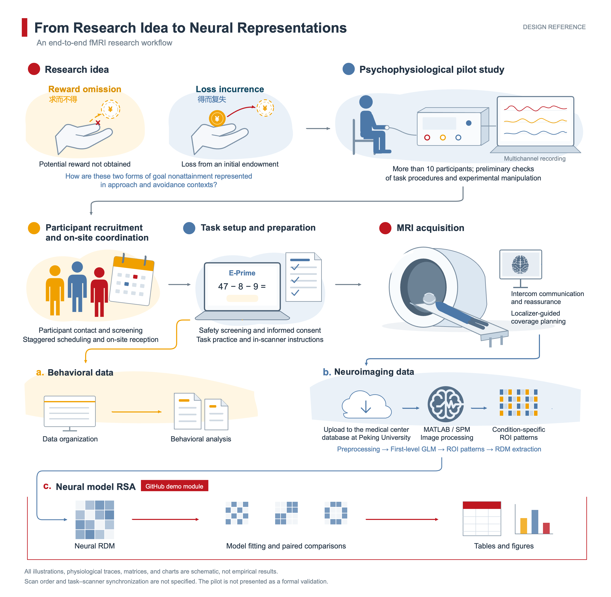

# Experimental Workflow and MRI Data Acquisition

[Project overview](README.md) · [Analysis index](analysis-index.md) · [Representational analysis and statistical methods](1.RSA/methods-and-statistics.md) · [Supplementary analyses](2.Supplementary/Supplementary.md)

The study was conducted at Huilongguan Brain Center, with platform support through collaborations with Peking University and Beijing University of Technology. I developed the research question and independently designed the experiment, recruited and contacted participants, coordinated on-site procedures, operated the scanner, acquired MRI data, and conducted the subsequent behavioral and neuroimaging analyses.

*Figure | Workflow from the research concept and psychophysiological pilot to the main experiment and data analysis. People, equipment, waveforms, matrices, and bar charts illustrate the stages of work. Behavioral and imaging data feed into their respective analysis pathways.*

## Research concept and pilot testing

The study operationalized "wanting it but not getting it" as reward omission and "having it only to lose it" as loss incurrence, alongside corresponding goal-attainment conditions. The four conditions were Reward-obtained, Reward-omission, Loss-avoidance, and Loss-incurrence.

Before the main fMRI acquisition, I conducted a pilot study with more than ten participants using a multichannel physiological recording system. Skin-conductance sensors were attached to the fingers, and skin conductance and other physiological signals were recorded. The pilot provided an initial check of task procedures and experimental manipulations in preparation for the main study.

## Recruitment and on-site organization

I advertised the study on WeChat and Xiaohongshu, collected registration forms, and screened participants based on whether they had taken China's national college entrance examination (Gaokao). I handled follow-up contact, scheduling, and participant reception on site.

Staggered arrival times coordinated task practice, pre-scan preparation, and scanning. I initially scheduled two participants per afternoon, then refined the schedule and handoffs between stages to acquire data from up to six participants in one day.

## Task checks and participant preparation

E-Prime presented the arithmetic problems and feedback and recorded responses, button presses, and event times. Before the main acquisition, I checked that the task ran from start to finish, verified the display-to-button mapping and task logic, and arranged practice outside the scanner room.

I reviewed screening forms and verbally confirmed safety information before entry to the scanner room. I also managed informed consent, clothing changes, checks of personal belongings, MRI-compatible glasses, head stabilization, and hearing protection. Consent covered procedures, expected duration, possible discomfort, voluntary participation and withdrawal, compensation, data use, and confidentiality. I provided time to read and ask questions, then arranged signing and storage of the consent forms. Safety questions were referred to authorized platform personnel under the center's procedures.

## MRI acquisition and communication

MRI data were acquired using syngo MR at a Siemens scanner console. Localizer images were acquired first and used to plan the coverage and orientation of subsequent scans.

Acquisition included high-resolution T1-weighted structural images, task-based and resting-state BOLD functional images, diffusion-weighted images for diffusion tensor imaging, and images for distortion correction.

During scanning, I gave instructions and checked participants' comfort through the intercom. Participants could signal discomfort by squeezing a handheld squeeze ball. Responses to the task were made with the response buttons.

## Data transfer and analysis

Images were uploaded from the scanner console to the collaborating platform's cloud, then downloaded and exported for analysis. E-Prime behavioral records were stored on my laptop and matched to imaging data by participant, scanning session, and condition.

Data were subsequently organized and analyzed using SPM, MATLAB, R, and Python. The representational analysis followed this sequence: condition beta images → ROI multivoxel patterns → participant-level neural RDMs → candidate-model fits and statistical comparisons.

Related materials: [Representational analysis and statistical methods](1.RSA/methods-and-statistics.md) · [Supplementary analyses](2.Supplementary/Supplementary.md)
